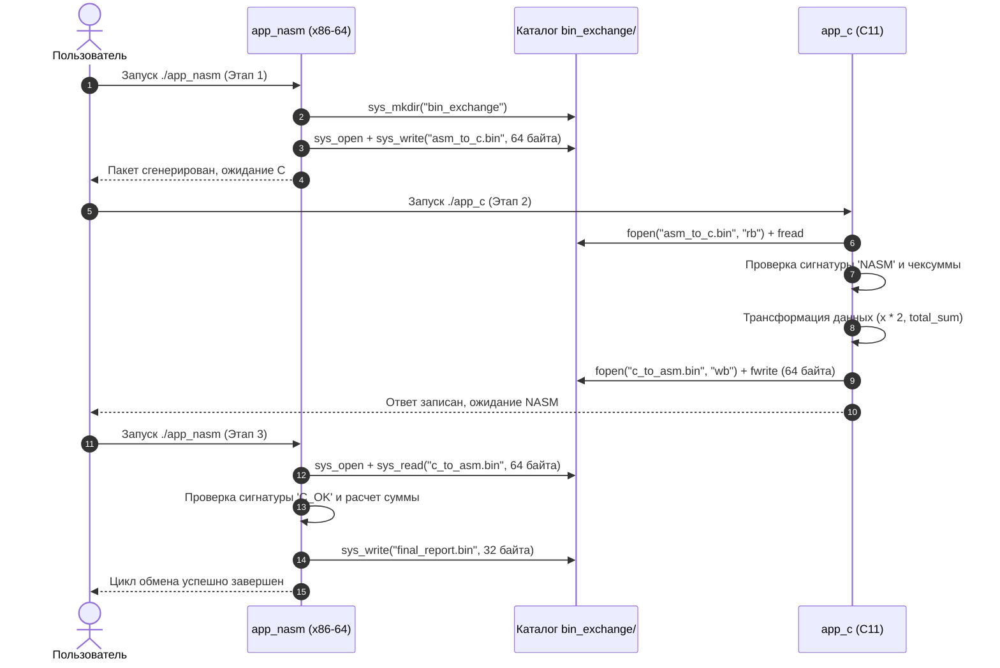

# Двустороннее бинарное взаимодействие между NASM (x86-64) и C (Linux)

Данный проект демонстрирует низкоуровневое взаимодействие двух независимых программ, написанных на **NASM (ассемблер x86-64)** и **C (C11)**. Программы обмениваются структурированными данными исключительно в **двоичном (бинарном) виде** через отдельный каталог проекта `bin_exchange/`.

---

## Содержание

1. [Архитектура и логика взаимодействия](#архитектура-и-логика-взаимодействия)
2. [Диаграмма последовательности (Sequence Diagram)](#диаграмма-последовательности)
3. [Спецификация двоичного протокола (Формат пакетов)](#спецификация-двоичного-протокола)
4. [Особенности реализации на NASM (x86-64)](#особенности-реализации-на-nasm)
5. [Особенности реализации на C](#особенности-реализации-на-c)
6. [Структура проекта](#структура-проекта)
7. [Инструкция по сборке и запуску](#инструкция-по-сборке-и-запуску)
8. [Анализ созданных бинарных файлов (Hex-дампы)](#анализ-созданных-бинарных-файлов)

---

## Архитектура и логика взаимодействия

Взаимодействие построено в виде 3-этапного цикла с гарантией целостности данных:

```
[NASM: app_nasm] ---> (asm_to_c.bin: 64 байта)  ---> [C: app_c]
       ^                                                    |
       |                                                    v
[NASM: app_nasm] <--- (c_to_asm.bin: 64 байта)  <-----------+
       |
       v
(final_report.bin: 32 байта)
```

1. **Этап 1 (Генерация, NASM):**
   - Программа [`app_nasm`](file:///home/mishka/asm/app_nasm.asm) создает поддиректорию `bin_exchange/`.
   - Формирует 64-байтный бинарный пакет с сигнатурой `NASM`, версией `1`, массивом из 5 чисел `int64` и контрольной суммой.
   - Сохраняет данные в файл `bin_exchange/asm_to_c.bin`.

2. **Этап 2 (Обработка и трансформация, C):**
   - Программа [`app_c`](file:///home/mishka/asm/app_c.c) открывает `bin_exchange/asm_to_c.bin` в бинарном режиме (`"rb"`).
   - Считывает ровно 64 байта в упакованную структуру C (`PacketFromAsm`).
   - Проверяет сигнатуру `NASM` и валидирует контрольную сумму.
   - Выполняет математическую обработку (каждое число умножается на 2, рассчитывается новая сумма).
   - Формирует ответный 64-байтный пакет с сигнатурой `C_OK` и сохраняет его в `bin_exchange/c_to_asm.bin`.

3. **Этап 3 (Верификация и отчет, NASM):**
   - Повторный запуск [`app_nasm`](file:///home/mishka/asm/app_nasm.asm) обнаруживает файл ответа `bin_exchange/c_to_asm.bin`.
   - Считывает данные напрямую через системный вызов ядра `sys_read`.
   - Проверяет сигнатуру `C_OK`, суммирует полученные числа и сверяет с контрольной суммой от C.
   - Записывает финальный отчет `bin_exchange/final_report.bin` (32 байта) с сигнатурой `DONE`.

---

## Диаграмма последовательности



---

## Спецификация двоичного протокола

Все структуры упакованы без выравнивающих пропусков (`#pragma pack(push, 1)` в C) и используют порядок байтов **Little-Endian** (стандарт для архитектуры x86-64).

### 1. Пакет от NASM к C (`asm_to_c.bin`) — 64 байта

| Смещение (байт) | Размер (байт) | Тип данных | Имя поля | Значение / Описание |
|---|---|---|---|---|
| `0x00`..`0x03` | 4 | `char[4]` | `magic` | `"NASM"` (`0x4E, 0x41, 0x53, 0x4D`) |
| `0x04`..`0x07` | 4 | `uint32_t` | `version` | `1` |
| `0x08`..`0x0B` | 4 | `uint32_t` | `count` | `5` (количество чисел) |
| `0x0C`..`0x0F` | 4 | `uint32_t` | `reserved` | `0` (зарезервировано) |
| `0x10`..`0x17` | 8 | `int64_t` | `numbers[0]` | `10` |
| `0x18`..`0x1F` | 8 | `int64_t` | `numbers[1]` | `25` |
| `0x20`..`0x27` | 8 | `int64_t` | `numbers[2]` | `42` |
| `0x28`..`0x2F` | 8 | `int64_t` | `numbers[3]` | `100` |
| `0x30`..`0x37` | 8 | `int64_t` | `numbers[4]` | `256` |
| `0x38`..`0x3F` | 8 | `uint64_t` | `checksum` | `433` (сумма элементов: 10 + 25 + 42 + 100 + 256) |

### 2. Пакет от C к NASM (`c_to_asm.bin`) — 64 байта

| Смещение (байт) | Размер (байт) | Тип данных | Имя поля | Значение / Описание |
|---|---|---|---|---|
| `0x00`..`0x03` | 4 | `char[4]` | `magic` | `"C_OK"` (`0x43, 0x5F, 0x4F, 0x4B`) |
| `0x04`..`0x07` | 4 | `uint32_t` | `version` | `1` |
| `0x08`..`0x0B` | 4 | `uint32_t` | `count` | `5` |
| `0x0C`..`0x0F` | 4 | `uint32_t` | `status_code`| `200` (статус успеха) |
| `0x10`..`0x17` | 8 | `int64_t` | `results[0]` | `20` (`10 * 2`) |
| `0x18`..`0x1F` | 8 | `int64_t` | `results[1]` | `50` (`25 * 2`) |
| `0x20`..`0x27` | 8 | `int64_t` | `results[2]` | `84` (`42 * 2`) |
| `0x28`..`0x2F` | 8 | `int64_t` | `results[3]` | `200` (`100 * 2`) |
| `0x30`..`0x37` | 8 | `int64_t` | `results[4]` | `512` (`256 * 2`) |
| `0x38`..`0x3F` | 8 | `uint64_t` | `total_sum` | `866` (сумма элементов: 20 + 50 + 84 + 200 + 512) |

### 3. Финальный отчет NASM (`final_report.bin`) — 32 байта

| Смещение (байт) | Размер (байт) | Тип данных | Имя поля | Значение / Описание |
|---|---|---|---|---|
| `0x00`..`0x03` | 4 | `char[4]` | `magic` | `"DONE"` (`0x44, 0x4F, 0x4E, 0x45`) |
| `0x04`..`0x07` | 4 | `uint32_t` | `status` | `0` (успех) |
| `0x08`..`0x0F` | 8 | `uint64_t` | `verified_sum`| `866` (проверенная сумма от C) |
| `0x10`..`0x17` | 8 | `uint64_t` | `salt_stamp` | `0x1337BEEF` (маркер завершения) |
| `0x18`..`0x1F` | 8 | `uint64_t` | `reserved` | `0` |

---

## Особенности реализации на NASM

Программа [`app_nasm.asm`](file:///home/mishka/asm/app_nasm.asm) написана на чистом x86-64 ассемблере и **не зависит от стандартной библиотеки Си (libc)**. Точкой входа является метка `_start`. Все взаимодействие с операционной системой выполняется через инструкцию `syscall`.

### Таблица использованных системных вызовов Linux x86-64

| Номер вызова (`RAX`) | Имя системного вызова | Регистры аргументов | Назначение в программе |
|---|---|---|---|
| `0` | `sys_read` | `RDI` = fd, `RSI` = buffer, `RDX` = count | Чтение двоичного файла ответа `c_to_asm.bin` |
| `1` | `sys_write` | `RDI` = fd, `RSI` = buffer, `RDX` = count | Вывод сообщений в консоль и запись бинарных файлов |
| `2` | `sys_open` | `RDI` = path, `RSI` = flags, `RDX` = mode | Открытие файлов (с флагами `O_CREAT \| O_WRONLY \| O_TRUNC` или `O_RDONLY`) |
| `3` | `sys_close` | `RDI` = fd | Закрытие файлового дескриптора |
| `21` | `sys_access` | `RDI` = path, `RSI` = 0 (`F_OK`) | Автоматическая проверка наличия файлов для определения этапа |
| `60` | `sys_exit` | `RDI` = exit_code | Завершение процесса |
| `83` | `sys_mkdir` | `RDI` = path, `RSI` = mode (`0755`) | Создание каталога обмена `bin_exchange/` |

### Соглашения по регистрам (System V AMD64 Syscall ABI)
- Номер системного вызова передается в регистре `RAX`.
- Аргументы передаются по порядку в регистрах: `RDI`, `RSI`, `RDX`, `R10`, `R8`, `R9`.
- Результат системного вызова возвращается в `RAX` (отрицательные числа соответствуют кодам ошибок `-errno`).

---

## Особенности реализации на C

Программа [`app_c.c`](file:///home/mishka/asm/app_c.c) демонстрирует безопасное чтение и формирование бинарных файлов:

1. **Строгая упаковка структур:**
   ```c
   #pragma pack(push, 1)
   typedef struct { ... } PacketFromAsm;
   #pragma pack(pop)
   ```
   Гарантирует отсутствие неявного выравнивания компилятором между полями (padding bytes).

2. **Работа с фиксированными типами:**
   Используются типы из `<stdint.h>`: `uint32_t`, `int64_t`, `uint64_t`, что исключает платформозависимые различия в размерах типов.

3. **Бинарные режимы ввода-вывода:**
   Файлы открываются с режимами `"rb"` и `"wb"`, что исключает трансформацию символов перевода строки.

4. **Визуализация (Hex Dump):**
   Реализована функция `print_hex_dump`, которая наглядно печатает сырые байты пакета и их символьное представление в консоль.

---

## Структура проекта

```
/home/mishka/asm/
├── app_nasm.asm         # Исходный код на ассемблере NASM (x86-64)
├── app_c.c              # Исходный код на языке C
├── Makefile             # Сценарий сборки, запуска и очистки
├── README.md            # Данная подробная документация
└── bin_exchange/        # Создаваемый каталог бинарного обмена
    ├── asm_to_c.bin     # Двоичные данные от NASM к C (64 байта)
    ├── c_to_asm.bin     # Двоичные данные от C к NASM (64 байта)
    └── final_report.bin # Финальный отчет NASM (32 байта)
```

---

## Инструкция по сборке и запуску

### Быстрый запуск всего цикла одной командой

Для автоматической сборки, прогона всех трех этапов и вывода шестнадцатеричных дампов выполните:

```bash
make run
```

---

### Пошаговый ручной запуск

Если вы хотите выполнить каждый этап вручную:

1. **Компиляция программ:**
   ```bash
   make
   ```
   *Будут созданы исполняемые файлы `app_nasm` и `app_c`.*

2. **Этап 1: Генерация бинарных данных ассемблером:**
   ```bash
   ./app_nasm
   ```
   *NASM создаст папку `bin_exchange/` и запишет файл `bin_exchange/asm_to_c.bin`.*

3. **Этап 2: Чтение, обработка и ответ программой на C:**
   ```bash
   ./app_c
   ```
   *C считает файл `asm_to_c.bin`, выведет шестнадцатеричный дамп, удвоит числа и запишет ответ в `bin_exchange/c_to_asm.bin`.*

4. **Этап 3: Финальная верификация ассемблером:**
   ```bash
   ./app_nasm
   ```
   *NASM считает `bin_exchange/c_to_asm.bin`, проверит сумму и сохранит отчет `bin_exchange/final_report.bin`.*

5. **Очистка скомпилированных файлов и каталога обмена:**
   ```bash
   make clean
   ```

---

## Анализ созданных бинарных файлов

Созданные бинарные файлы можно исследовать с помощью утилит `hexdump` или `xxd`:

### 1. `bin_exchange/asm_to_c.bin`
```bash
hexdump -C bin_exchange/asm_to_c.bin
```
Вывод:
```
00000000  4e 41 53 4d 01 00 00 00  05 00 00 00 00 00 00 00  |NASM............|
00000010  0a 00 00 00 00 00 00 00  19 00 00 00 00 00 00 00  |................|
00000020  2a 00 00 00 00 00 00 00  64 00 00 00 00 00 00 00  |*.......d.......|
00000030  00 01 00 00 00 00 00 00  b1 01 00 00 00 00 00 00  |................|
```
- `4e 41 53 4d` — ASCII строка "NASM".
- `01 00 00 00` — Версия 1 (32-битное число в Little-Endian).
- `05 00 00 00` — Количество элементов 5.
- `0a ...` — Число 10 (0x0A).
- `19 ...` — Число 25 (0x19).
- `2a ...` — Число 42 (0x2A).
- `64 ...` — Число 100 (0x64).
- `00 01 ...` — Число 256 (0x0100).
- `b1 01 ...` — Контрольная сумма 433 (0x01B1).

### 2. `bin_exchange/c_to_asm.bin`
```bash
hexdump -C bin_exchange/c_to_asm.bin
```
Вывод:
```
00000000  43 5f 4f 4b 01 00 00 00  05 00 00 00 c8 00 00 00  |C_OK............|
00000010  14 00 00 00 00 00 00 00  32 00 00 00 00 00 00 00  |........2.......|
00000020  54 00 00 00 00 00 00 00  c8 00 00 00 00 00 00 00  |T...............|
00000030  00 02 00 00 00 00 00 00  62 03 00 00 00 00 00 00  |........b.......|
```
- `43 5f 4f 4b` — Сигнатура "C_OK".
- `c8 00 00 00` — Код ответа 200 (0xC8).
- `14 ...` — Число 20 (10 * 2).
- `32 ...` — Число 50 (25 * 2).
- `54 ...` — Число 84 (42 * 2).
- `c8 ...` — Число 200 (100 * 2).
- `00 02 ...` — Число 512 (256 * 2).
- `62 03 ...` — Новая сумма 866 (0x0362).

### 3. `bin_exchange/final_report.bin`
```bash
hexdump -C bin_exchange/final_report.bin
```
Вывод:
```
00000000  44 4f 4e 45 00 00 00 00  62 03 00 00 00 00 00 00  |DONE....b.......|
00000010  ef be 37 13 00 00 00 00  00 00 00 00 00 00 00 00  |..7.............|
```
- `44 4f 4e 45` — Сигнатура "DONE".
- `00 00 00 00` — Статус 0 (успех).
- `62 03 ...` — Подтвержденная сумма 866 (0x0362).
- `ef be 37 13` — Метка `0x1337BEEF`.
